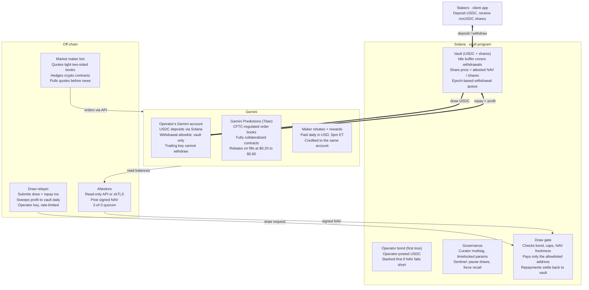

# AGENTS.md — Maker-Rebate Vault

A Solana staking protocol that funds a market maker on Gemini Predictions. Stakers deposit USDC into an on-chain escrow vault; an operator draws from it, under on-chain rules, to quote tight two-sided markets on Gemini; stakers earn Gemini's maker rebates plus any spread the bot keeps, minus trading losses and fees.

This file is the source of truth for anyone (human or agent) working on the project. Read it before changing code. Facts about Gemini programs are as of 2026-11-16 and change often — re-check the linked sources before relying on a number.

---

## 1. Summary

The hard part is not the vault code. Once USDC lands on Gemini, the smart contract can no longer enforce anything, so trust has to come from a posted operator bond, draw caps, address allowlisting and frequent attested NAV.

The pitch:

- Stakers earn on idle USDC by funding a market maker
- Adds liquidity to Gemini Predictions
- Tight spreads to maximise maker rebates and fills
- Stakers participate without running infrastructure or a proprietary algorithm
- An on-chain escrow releases funds only when set conditions hold

The protocol has three parts: the **on-chain escrow** (Solana program), the **client interface**, and the **market maker bot** (plus a draw relayer and independent attestors).

### Key decisions

| Decision | Recommendation | Why |
| --- | --- | --- |
| Deposit asset | USDC; optionally a SOL-to-USDC swap at deposit | Gemini Predictions settles and pays rebates in USD, and Gemini accepts USDC on Solana. SOL deposits would add price risk and a conversion leg on every draw and repay |
| Vault model | Copy Morpho Vault V2's roles: owner, curator, allocator (the operator), sentinel, with timelocks | A proven split where the curator cannot hurt depositors without a timelock and a sentinel can de-risk at once |
| Where funds can go | One Gemini deposit address stored in config; changing it is timelocked | The operator can never redirect a draw to its own wallet |
| How stakers are protected | Operator first-loss bond, draw caps, idle buffer, attested NAV, circuit breakers | See section 5 |
| Who operates | A legal entity holding the Gemini account, likely needing commodity pool operator registration or an exemption | Pooling outside money to trade event contracts; see section 8 |

---

## 2. Where the yield comes from

While Gemini waives maker fees (through Dec 31, 2026), a contract filled at 50¢ earns about half a cent in rebate, roughly 1% of the capital it ties up. Once the waiver ends, the net rebate drops to about one sixth of that unless Gemini extends it. Spread capture is the swing factor, and with quotes this tight it is often negative after adverse selection.

Gemini's Maker Rebate Program pays a share of the taker fee on every maker fill:

```
Maker rebate = Rebate rate × Taker rate × C × P × (1 − P)
```

`C` is contracts filled and `P` is the fill price in dollars. Terms as of 2026-11-16:

- Rebate rate is 0.30 in every category since June 11, 2026; Gemini's worked examples use a 0.07 taker rate
- Only fills priced $0.20 to $0.80 earn a rebate, capped at 5% of fill notional
- Paid daily at 5pm ET in USD, rounded down to the cent
- Gemini can amend rates, eligibility or end the program

| Fill price | Rebate per 100 contracts | Normal maker fee | Net during fee waiver | Net after waiver |
| --- | --- | --- | --- | --- |
| $0.20 | $0.33 | $0.28 | +$0.33 | +$0.05 |
| $0.40 | $0.50 | $0.42 | +$0.50 | +$0.08 |
| $0.50 | $0.52 | $0.44 | +$0.52 | +$0.08 |
| $0.80 | $0.33 | $0.28 | +$0.33 | +$0.05 |

Rebate and normal fee come from Gemini's examples; the waiver column applies the Maker Fee-Free Trading Promo (Sep 2 to Dec 31, 2026).

### Income lines

1. **Maker rebates** — need fills, so the bot must quote at or near the best price.
2. **Liquidity rewards** — Gemini's Liquidity Rewards Program pays resting two-sided quotes within a $0.10 spread and at least 100 contracts a side, scored each minute, from pools of $10 to $10,000 a day. An order can earn this and the rebate at once, but members with an active Market Maker Agreement are excluded.
3. **Spread capture** — bid-ask earned minus losses to informed takers. Track it with markouts, not assumptions.
4. **Market Maker Program incentives** — by application to Gemini; weigh against losing liquidity rewards.

### Capital and return model

Capital is fully collateralised: buying YES at `P` locks `P`, selling it locks `1 − P`, so 100 contracts quoted both sides at 50¢ tie up about $100. A first-cut staker return:

```
APY ≈ 365 × (daily filled notional / vault capital) × r_net + rewards − trading losses − fees
```

Daily filled notional per dollar of capital is the unknown that decides whether this works; Phase 0 exists to measure it.

Proposed split, to tune: stakers take returns first, the operator takes a 20% performance fee above a hurdle, and the operator bond absorbs losses before stakers do.

---

## 3. Architecture

USDC moves only on the money paths (`==>`), between the vault and one allowlisted Gemini account. Everything the operator and attestors do is a request, an order or a proof (`-->`) that the draw gate checks.



### Components

| Component | Runs on | Job | Trusted for |
| --- | --- | --- | --- |
| Vault program | Solana | Holds undrawn USDC, issues shares, runs the draw gate, holds the bond | Nothing beyond audited code |
| Operator's Gemini account | Gemini | Holds drawn USDC and open positions | Withdrawal allowlist and the legal agreement |
| Market maker bot | Operator servers | Quoting, hedging, risk limits | Staying inside limits, checked by attestation |
| Draw relayer | Operator servers | Draw, repay and sweep transactions | Nothing: the gate checks every call |
| Attestors | Independent parties | Read Gemini balances and positions, sign NAV | Honest NAV, via quorum now and zkTLS later |
| Client app | Web | Deposits, withdrawals, transparency | Display only |

---

## 4. On-chain escrow program

One Anchor program holds deposits, issues vault shares (mvUSDC), and releases USDC only through a draw gate that checks every assurance condition in the same transaction. Share price moves only when a quorum-signed NAV report lands.

### Accounts (PDAs)

| Account | Holds |
| --- | --- |
| `VaultConfig` | Owner, curator, sentinel and operator keys; USDC mint; the one allowed Gemini deposit address; caps, bond ratio, buffer %, NAV staleness limit, drawdown limits, fee settings; attestor set and quorum; pending timelocked changes |
| `VaultState` | Total shares, outstanding drawn principal, last NAV and timestamp, current epoch, paused flag |
| Idle USDC token account | Undrawn deposits; pays instant withdrawals |
| mvUSDC share mint | SPL token for vault shares, mint authority = program |
| `OperatorBond` | Operator-posted USDC, locked while any draw is outstanding |
| `DrawTicket` | Amount, time, declared market categories, expiry, status |
| `WithdrawRequest` | Owner, shares, epoch requested |
| `NavReport` | Epoch, Gemini equity, positions hash, rebate payout total, attestor signatures |

### Instructions

| Instruction | Caller | Effect |
| --- | --- | --- |
| `deposit` | Staker | USDC in; shares minted at the next epoch's price |
| `request_withdraw` / `claim_withdraw` | Staker | Queue shares; claim USDC once the epoch settles and the buffer covers it |
| `post_bond` / `release_bond` | Operator | Add bond; release only the part above what outstanding draws require |
| `request_draw` | Operator relayer | Runs every gate check, then sends USDC to the stored Gemini address |
| `repay` | Anyone | USDC back into the idle account; reduces outstanding principal |
| `submit_nav` | Attestors | Verifies quorum signatures (Solana ed25519 program) and records the report |
| `settle_epoch` | Anyone (crank) | Applies the latest NAV, mints queued deposits, fills queued withdrawals, takes fees |
| `pause` / `force_recall` | Sentinel | Stops new draws; opens a repayment deadline for all outstanding principal |
| `slash_bond` | Anyone, if conditions hold | Moves bond into the vault when NAV shortfall or a missed recall deadline is proven on-chain |
| `propose_config` / `accept_config` | Curator, then anyone after timelock | Changes caps, address, attestors; sentinel can veto while pending |

### Share accounting

- NAV = idle USDC + attested Gemini equity (cash plus positions marked to mid); the operator bond is not counted
- Share price = NAV ÷ total shares; deposits and withdrawals settle once a day, after the 5pm ET rebate payout and the NAV report that follows it, so nobody can deposit just before a known rebate credit
- Shares are a plain SPL token at first; Token-2022 transfer hooks can add depositor allowlisting if counsel requires it

### Withdrawal queue

- Up to the idle buffer: paid at the next epoch
- Beyond it: the queue automatically raises a recall on the operator for the shortfall, with a deadline (proposed 48 hours, to cover Gemini withdrawal processing)
- Missed deadline: sentinel pauses draws and `slash_bond` becomes callable

---

## 5. Trust and assurance conditions

A draw succeeds only if all on-chain checks pass in the same transaction; the Gemini-side and legal controls cover what the chain cannot see. Numbers below are starting values to tune in Phase 1, not tested limits.

### Checked on-chain at every draw

| # | Condition | Proposed default |
| --- | --- | --- |
| 1 | Bond coverage: operator bond ≥ a share of outstanding + requested principal | 15% |
| 2 | Absolute cap on outstanding principal | Set per phase; low at launch |
| 3 | Relative cap: outstanding ≤ a share of NAV | 60% |
| 4 | Idle buffer after the draw ≥ max(buffer %, queued withdrawals) | 20% of NAV |
| 5 | Fresh NAV: last report signed by the attestor quorum and recent | 2-of-3, under 1 hour old |
| 6 | Health: attested Gemini equity ≥ outstanding principal × threshold | 0.97 |
| 7 | Destination is the stored Gemini deposit address; changes timelocked | 7-day timelock |
| 8 | Not paused, no open recall, draw size ≤ per-draw limit | Per-draw limit 25% of cap |

### Circuit breakers (on-chain, triggered by NAV reports)

- Equity below 95% of outstanding: new draws blocked, sentinel alerted
- Equity below 90%: automatic full recall; bond slashed to cover the gap
- No NAV report for 24 hours: draws blocked, recall opens
- Missed recall deadline: bond slashed in full, operator role revocable by the curator

### Gemini-side controls (attested, not enforced by the chain)

- Withdrawal address allowlist on the Gemini account containing only the vault's USDC address, so a stolen trading key cannot move funds elsewhere
- The bot's API key can trade but not withdraw; attestors get read-only keys (confirm Predictions honours Gemini's role-scoped keys)
- Risk limits the bot must stay inside, checked against each positions snapshot: per-contract and per-event exposure, allowed categories, net inventory
- Daily sweep: after the 5pm ET payout, cash above principal plus a working float goes back to the vault

### Legal and operational controls

- Operator agreement (or a special-purpose entity holding the Gemini account) that makes the vault the beneficial owner of drawn funds
- Attestors run by parties independent of the operator; zkTLS proofs of Gemini API responses replace signatures once feasible
- Quarterly recall drill: recall everything, measure time to repay

---

## 6. Market maker bot

The bot's job is to collect rebates without bleeding more to informed takers than it earns; the strongest version hedges every fill it can and quotes only where flow is mostly uninformed.

### Strategy

- Quote two-sided at or one tick inside the best price, only inside the $0.20 to $0.80 rebate band
- Favour crypto and commodity price contracts: fills can be delta-hedged on Gemini spot or perpetuals, turning the book into near-pure rebate harvesting
- Treat sports, politics and economics contracts as unhedgeable: smaller size, wider quotes near scheduled news (data releases, game start, debates), pull quotes in live play
- Skew quotes against inventory; cap net exposure per contract, per event and per category
- Use Gemini's collateral return on mutually exclusive outcome groups to free capital when quoting several outcomes of one event
- Stay clear of anything that reads as wash trading, spoofing or multi-account play: Gemini disqualifies it from incentive programs

### Daily lifecycle

1. 5pm ET: Gemini pays maker rebates; liquidity rewards follow at about 5:30pm ET.
2. Attestors snapshot Gemini equity, positions and the day's rebate payouts, then post a signed NAV report.
3. `settle_epoch` runs: share price updates, queued deposits and withdrawals settle, fees accrue.
4. The relayer sweeps surplus back to the vault, or requests a new draw if the bot is capital-constrained and every gate passes.
5. Through the day the bot quotes, hedges and reports; attestors post hourly NAV so draws always have a fresh report.
6. Kill switch: cancel all orders on breaker, feed outage or exchange status change.

### Build

- Gemini Prediction Markets REST and WebSocket APIs (order events, positions, balance updates) and the official TypeScript SDK; accept the Predictions terms via API before the first live order
- Develop against Gemini's demo environment; promote to live with operator capital only
- Rebate payouts are readable from the API (`/v1/prediction-markets/maker-rebate/payouts`), which attestors use to prove rebate income
- Metrics that decide if it works: fill rate, markouts at 1 minute, 5 minutes and settlement, rebate per dollar filled, PnL split into rebate, spread and hedge

---

## 7. Client interface

The app's main job is to make the off-chain leg auditable: every staker should see, at a glance, how much is drawn, how much bond stands behind it, and when the last proof landed.

| View | For | Shows and does |
| --- | --- | --- |
| Vault | Stakers | Connect wallet, deposit USDC (optional SOL swap), request and claim withdrawals, queue position, share price history, return split into rebates, rewards and spread |
| Health | Everyone | Outstanding principal vs bond vs NAV, idle buffer, breaker status, last NAV report with its signatures or proofs, daily rebate payouts |
| Operator | Operator | Draw and repay requests, gate check preview (which condition would fail), recall deadlines, risk-limit usage |
| Governance | Curator, sentinel | Pending timelocked changes, veto, pause, force recall |

Stack: Next.js, Solana wallet adapter, an Anchor-generated TypeScript client, and an indexer for program events. Risk disclosures and any depositor eligibility checks counsel requires sit in front of the first deposit.

---

## 8. Risks

The two risks most likely to sink this are regulatory (pooling outside money to trade event contracts) and economic (the fee waiver ending on Dec 31, 2026). Both should be settled in Phase 0, before any code ships. This is a planning note, not legal advice.

| Risk | What happens | Mitigation |
| --- | --- | --- |
| Regulatory status | Event contracts are treated as swaps, and anyone pooling investor money to trade them is a commodity pool operator who must register with the CFTC and join the NFA unless exempt. Vault shares may also raise securities questions | Counsel before launch; register or fit an exemption; restrict depositors if required |
| Gemini account terms | A pooled account trading for others may breach Gemini's terms; Gemini can freeze it | Get Gemini's written approval; apply to its Market Maker Program |
| Incentive changes | Gemini can amend or end rebates and the fee waiver; post-waiver net rebate is about one sixth of today's | Model on post-waiver economics; auto-pause draws when trailing net edge turns negative |
| Adverse selection | Tight quotes get picked off by better-informed takers, especially in live sports and news events | Market selection, hedging, markout-driven quote widening |
| Operator theft or error | Funds off-chain can be lost regardless of contract logic | Bond, caps, allowlisted withdrawals, legal agreement, independent attestors |
| Binary settlement loss | Unhedged inventory at resolution goes to $0 or $1 | Per-event caps; flatten before resolution where possible |
| Exchange counterparty | Gemini outage, insolvency or frozen withdrawals | Relative cap keeps part of NAV on-chain; recall drills |
| Attestor failure or collusion | NAV is wrong, so share price and gate checks are wrong | Independent quorum; zkTLS proofs; staleness breaker |
| Bank run | Withdrawals exceed idle buffer | Epoch queue, recall deadline, bond slashing |
| Smart contract bug | Funds drained on-chain | Audits, low caps at launch, timelocks, sentinel pause |

---

## 9. Build plan

Prove the trading edge with the operator's own money before writing the vault. Phase 2 is the first phase that takes deposits. Each gate must pass before the next phase starts.

1. **Phase 0 · Validate the edge (no outside money)**
   - Legal opinion on CPO status and Gemini terms; open the operator's Gemini account
   - Run the bot in Gemini's demo environment, then small live size; log fills, markouts and rebates
   - **Gate:** positive net edge on post-waiver fee economics over 30 days
2. **Phase 1 · Operator-capital pilot**
   - Bot trades operator money only; attestors publish a daily NAV report to devnet
   - Build the risk engine, kill switch and PnL attribution (rebate, spread, hedge)
   - **Gate:** attested NAV matches Gemini statements every day; drawdown stays inside limits
3. **Phase 2 · Vault MVP, capped** (first phase with staker deposits)
   - Anchor program, client app, multisig roles; independent security audits
   - Mainnet launch with an allowlist of depositors and a low TVL cap
   - **Gate:** audits closed, legal structure in place, recall drill passed
4. **Phase 3 · Scale**
   - Raise caps, add zkTLS proofs, publish the transparency page
   - Open the vault to more curated operators and venues, Morpho-style

The 30-day test and gate criteria are proposals to agree before Phase 0 starts; no phase has a fixed duration until Phase 0 shows how much volume the bot can fill.

---

## 10. Sources

- [Gemini Maker Rebate Program](https://developer.gemini.com/prediction-markets/maker-rebate-program)
- [Gemini Maker Fee-Free Trading Promo](https://developer.gemini.com/prediction-markets/maker-fee-free-trading-promo)
- [Gemini Liquidity Rewards Program](https://developer.gemini.com/prediction-markets/liquidity-rewards-program)
- [Gemini Market Maker Program](https://developer.gemini.com/prediction-markets/market-maker-program)
- [Gemini Prediction Markets API](https://developer.gemini.com/products/prediction-markets)
- [Gemini API revision history](https://developer.gemini.com/changelog/revision-history)
- [Gemini: USDT and USDC transfers on Solana](https://www.gemini.com/blog/gemini-now-offers-usdt-and-usdc-transfers-on-solana)
- [Morpho Vault V2 roles and capabilities](https://docs.morpho.org/curate/concepts/roles/)
- [WilmerHale: Want to get into CFTC-regulated event contract markets?](https://www.wilmerhale.com/en/insights/client-alerts/20260415-want-to-get-into-cftc-regulated-event-contract-markets-heres-how-it-works)
