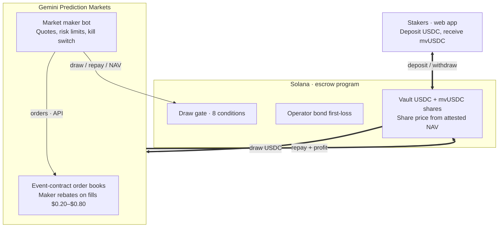

# Mouse Trap

Stakers deposit USDC on Solana and receive **mvUSDC** shares. A market-making bot earns **Gemini Prediction Markets** maker rebates; USDC leaves the vault only when an on-chain **draw gate** passes eight checks.

| Folder | What |
| --- | --- |
| [`escrow/`](escrow) | Anchor vault: deposits, draw gate, NAV, epochs, breakers |
| [`bot/`](bot) | Gemini MM bot, relayer, API (`:8787`, dashboard `:8788`) |
| [`web/`](web) | Vault, Health, Operator UI |

Protocol detail: [AGENTS.md](AGENTS.md).

## Run the demo

**Recommended (Solana + UI):** Node 22.4+, Solana CLI, Anchor 1.2, Phantom or Solflare on **Solana Localnet**.

```bash
cd bot && npm install && npm run localnet          # terminal 1
cd bot && npm run localnet:setup                   # terminal 2
npm run test-mode -- --chain --offline             # terminal 2 (omit --offline for live Gemini books)
cd web && npm install && npm run dev               # terminal 3
```

[http://localhost:3000](http://localhost:3000) — connect wallet → **Get test USDC** → deposit → wait ~1 min → claim mvUSDC. **Health** = gate checks; **Operator** = quotes and relayer.

**No Solana:** `cd bot && npm run test-mode`, then `cd web && npm run dev`.

## Architecture

USDC moves only on the money paths (`==>`). Operator and attestor actions are requests or proofs (`-->`) checked by the draw gate.



1. **Web** signs deposits/withdrawals on chain, or reads the bot at `127.0.0.1:8787`.
2. **Escrow** holds idle USDC, enforces the draw gate, mints shares at epoch NAV.
3. **Bot** streams Gemini books, quotes, posts NAV, draws/repays/sweeps through the program.

## On-chain addresses

| | |
| --- | --- |
| Program ([devnet explorer](https://explorer.solana.com/address/2rhxbbbqDtRPfGDAcd4LK7iqbR6Ro58R3QLs1NG9EZfd?cluster=devnet)) | `2rhxbbbqDtRPfGDAcd4LK7iqbR6Ro58R3QLs1NG9EZfd` |
| Devnet test USDC | `BkXxTg3PRX63oTEuXsiBThrsXitKa9fcXHjVFjE6zC6M` |
| Vault config / state / idle USDC / mvUSDC mint / bond | `CtVSdYiQiJyvJTfmeq4VoV9okQEsB9ABnrNb5LDiuhmJ` · `ERG5TtsWE9FE9a28Vbst7ZAF1w8LQBVPs1cscEHCw3Nu` · `P6KaEJnxBmdLBQH5R9SWrL6dr4cCacGzbtGeKCUoxAF` · `HW1bmJ8Dw8TcvwdQdzxBs6njPqF9nQ4tuVwFQbixMQG5` · `C35tpxotGchz63ZUyQo3TfJkmz9Cmi9MguUMXZk1jVQA` |

**Localnet:** deploy from `escrow/`, then `npm run localnet:setup` in `bot/`. **Tests:** `cd escrow && anchor build --arch v0 && cargo test`.

## Solana

Anchor program with SPL USDC and mvUSDC; fixed-seed PDAs; **ed25519**-verified NAV; draw pays only the Gemini address set at `initialize`. Staker txs: Next.js + wallet-adapter + IDL client in `web/src/lib/chain.ts`. End-to-end chain demo: `npm run test-mode -- --chain`.

## Gemini Prediction Markets

Core integration: **`@gemini-markets/sdk`** — public REST/WebSocket for events, books, and trades (`bot/src/exchange/geminiFeed.ts`); authenticated orders in demo/live (`gemini.ts`). Rebates follow [Gemini’s maker rebate formula](https://developer.gemini.com/prediction-markets/maker-rebate-program). Test mode uses live book data; orders are simulated unless you run `npm run demo` / `npm run live`.

## Economics and risks

**Income:** maker rebates on fills between $0.20–$0.80, minus trading losses and fees; optional spread. Stakers take PnL first; operator **20%** performance fee above a high-water mark; **15%** USDC bond is first loss.

**Draw gate (defaults):** bond ≥ 15% of outstanding · outstanding ≤ 60% NAV · ≥ 20% idle buffer after draw · NAV &lt; 1h old · Gemini equity ≥ 97% of drawn principal · payout only to stored Gemini address · per-draw ≤ 25% of cap.

**Breakers:** equity &lt; 95% stops new draws; &lt; 90% recall + bond slash; 24h without NAV opens recall.

**Limits:** capital on Gemini is not enforced by the program (bond, caps, attestations). Hackathon uses one attestor key; hedging and liquidity rewards are not in the bot; test-mode PnL replays real 24h Gemini volume into 1-minute epochs. Regulatory and full risk notes: [AGENTS.md](AGENTS.md).